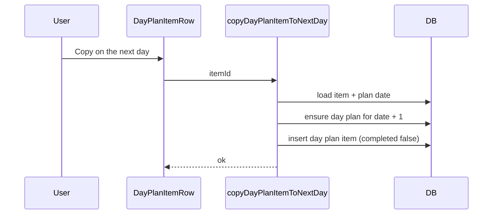

## Summary

Right-click a **day plan item** → **Copy on the next day** duplicates it on tomorrow’s **day plan** (creates that **day plan** if missing). The source item is unchanged; the copy is incomplete and has no **reminder**.



```diff
 <DayPlanItemRow> (components/day-plan-timeline.tsx)
   <ContextMenuContent>
     Remind me
+    Copy on the next day → copyDayPlanItemToNextDay
     Cancel reminder
```

## Evidence

- **Before:** Context menu had no copy action; next day’s plan could not receive a duplicate from the current item.
- **After:** `pnpm typecheck` passes.

## Merge Danger

**Door:** two-way

Revert removes the server action and menu item; no schema migration.

**Blast Radius:** localized

Day plan page only — one extra row insert per use; no effect on **todos**, **reminders**, or other routes.

## Test plan

- [ ] Right-click a **day plan item** → **Copy on the next day**
- [ ] Open the next calendar date on the day plan page and confirm a new item with the same title and **target time**, not completed
- [ ] Confirm the original item is unchanged
- [ ] Repeat when the next day has no **day plan** yet (plan should be created)
